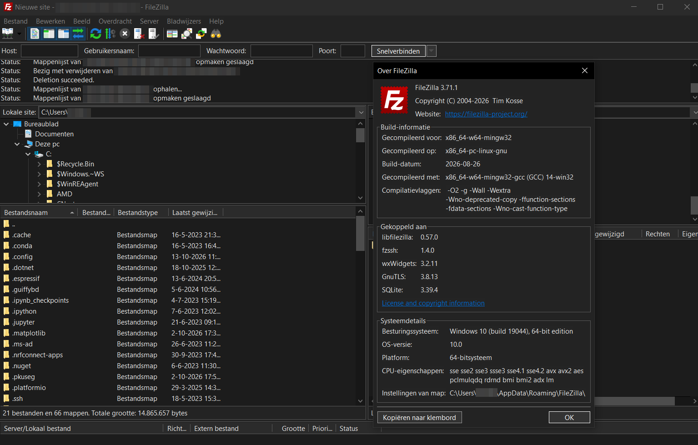
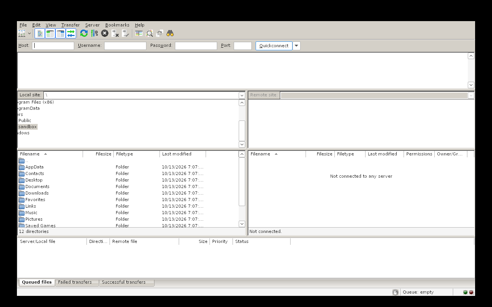
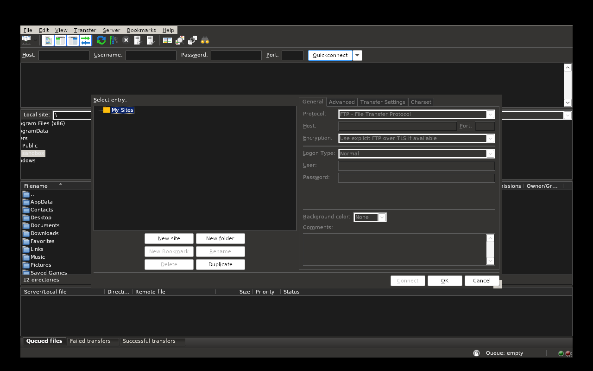
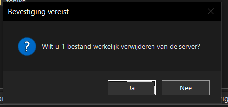

# Dark mode for FileZilla (unofficial)

FileZilla on Windows has no dark mode, and the Windows "dark app mode" setting does nothing for it. This is a small DLL that adds one. It's free, open source, and has no installer: two files go next to `filezilla.exe`.

Not affiliated with the FileZilla project. FileZilla is a trademark of its owner.



<details>
<summary>More screenshots</summary>

Without the DLL (under Wine):



Site Manager (under Wine):



A confirmation box on Windows 10:



The two Wine screenshots can't show dark title bars or the dark menu bar, so those look light there. The main window and the message box are from Windows 10 (user names and paths are blurred).
</details>

## Install

1. Download `version.dll` and `fz-darkmode.ini` from the [latest release](../../releases/latest).
2. Copy both into the FileZilla folder, next to `filezilla.exe`. That's usually `C:\Program Files\FileZilla FTP Client\`, and Windows will ask for administrator rights.
3. Start FileZilla.

By default it follows Windows: Settings > Personalization > Colors > "Choose your default app mode". Set it to Dark and FileZilla is dark; set it to Light and nothing changes.

To remove it, delete `version.dll` (and the `.ini` and `fz-darkmode.log` if you want). FileZilla itself is never modified; everything happens in memory while it runs.

## What it works with

- **Tested:** FileZilla 3.71.1, 64-bit, on Windows 10.
- **Should work, not tested:** Windows 11, and 64-bit FileZilla from 3.63.0 on, since those are built with wxWidgets 3.2 like 3.71.1.
- **Doesn't work:** 32-bit FileZilla (the DLL is 64-bit), and versions before 3.63.

The DLL doesn't check the FileZilla version, so on an untested version it loads anyway and may look wrong. If so, set `Mode=light` or delete the DLL.

## Settings

`fz-darkmode.ini` is optional and is read at startup:

```ini
[DarkMode]
; auto  = follow Windows (Settings > Personalization > Colors > app mode)
; dark  = always dark
; light = always light (dark mode off)
Mode=auto

; 1 = write fz-darkmode.log (next to this DLL, or in %TEMP% if not writable)
; 0 = no log file
Log=1

; Windows file dialogs (Open, Save, choose folder) and the confirmation when deleting local files:
; auto  = dark on Windows 11, light on Windows 10
; dark  = keep dark mode; Windows themes the dialog itself (fully dark on Windows 11)
; light = dark mode paused while the dialog is open (fully light dialog)
FileDialog=auto
```

## Known issues

- **Some dialogs are light on Windows 10.** The file dialogs and the "move to Recycle Bin?" question when you delete a local file are drawn by Windows. Windows 10 can't make them fully dark (you get a mix of black and white), so the DLL switches dark mode off while they're open. On Windows 11 they stay dark.
- **Message boxes look a bit old.** FileZilla's questions and errors (like "Are you sure you want to delete this file from the server?") normally use a Windows task dialog, which can't be darkened from outside. The DLL makes FileZilla use the classic message box instead, which it can paint dark. Same buttons and text, older look.
- **Not checked yet:** whether the FileZilla updater keeps `version.dll`, the text on the green transfer progress bar, a second monitor with a different scale, and the local-delete confirmation on real Windows (only tried under Wine). If dark mode is gone after an update, copy the files again.

## Problems

Open an issue and attach a screenshot and `fz-darkmode.log` (it sits next to the DLL, or in `%TEMP%`). Please say which FileZilla version and which Windows you use.

## Antivirus warnings

Loading a `version.dll` from a program's folder is called DLL sideloading, and malware uses the same trick, so a scanner may flag the file. The whole source is in this repo and it's small enough to read. You can also build it yourself (below). The DLL only does anything inside `filezilla.exe`; in other programs it just forwards to the real `version.dll`.

## How it works

Windows looks in the program's folder before `System32`, so FileZilla loads this `version.dll` instead of the real one. It forwards all 17 functions to the real DLL (`src/proxy.c`). Inside `filezilla.exe` it also:

- replaces `GetSysColor` in FileZilla's wxWidgets DLLs, so wxWidgets draws with dark colors (`src/wx_hooks.c`). FileZilla already adapts its own colors to a dark background;
- sets a window hook to give windows a dark title bar and dark themes, and to draw the controls Windows can't (check boxes, tabs, status bar, column headers, the menu bar) (`src/darkmode.c`, `src/controls.c`, `src/menus.c`);
- keeps text readable by raising its contrast to at least 4.5:1 (`src/colors.c`).

## Build

You need MinGW-w64 (on Debian or Ubuntu: `apt install mingw-w64`). Then:

```sh
./build.sh
```

This gives you `dist/version.dll` and a copy of the ini. It builds 64-bit only.

## License

[MIT](LICENSE). Use it, copy it, change it, give it to others.
